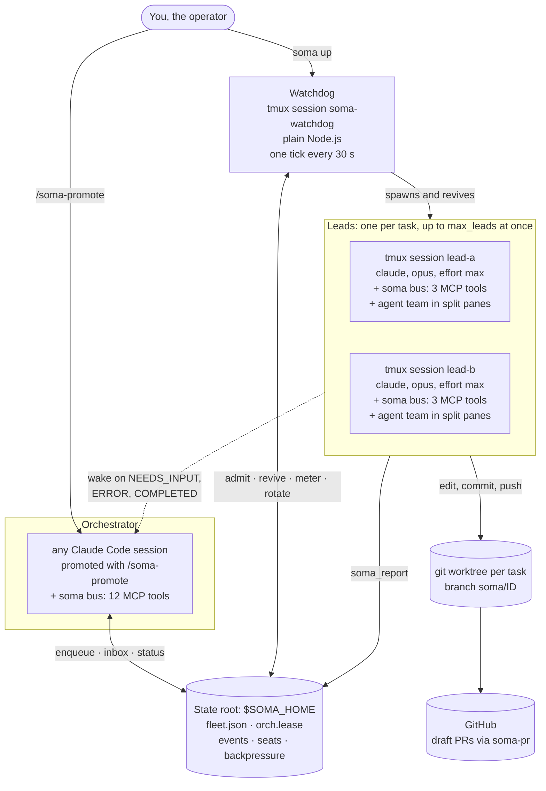
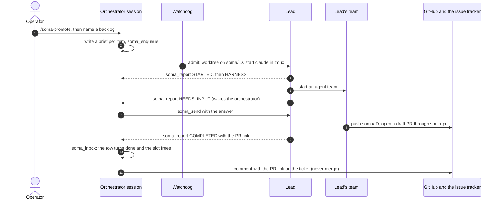

# claude-soma-lite

**Promote any Claude Code session to orchestrator of a local fleet: every task in your backlog gets
its own Claude Code lead, tmux session and git worktree, and comes back as a draft pull request.**

[](https://nodejs.org/)
[](#installation)
[](package.json)
[](test/)
[](LICENSE)

https://github.com/user-attachments/assets/e918ad06-3a6c-480c-8cb0-6c2a09de5714

*The 88-second narrated film: a plain-language story of soma in action, then a "For developers" section of real captured output. If the player does not load, [download the MP4](docs/media/showcase.mp4). [How the video was made](docs/media/README.md).*

> **Status: pre-release (0.1.0). Supervised use only.**
> soma starts Claude Code sessions that run unattended in your repositories with permission
> prompts bypassed, guarded by deny rules and hooks that have a documented ceiling. The project's
> own verdict: **trustworthy for a supervised first run, not yet for ten unsupervised agents in your
> repos.** Read [`RUNBOOK.md`](RUNBOOK.md) before running anything, and §11 of it before trusting
> anything.

## Contents

- [What it is and why](#what-it-is-and-why)
- [Features](#features)
- [How it works](#how-it-works)
- [Quick start](#quick-start)
- [Installation](#installation)
- [Configuration: `soma.json`](#configuration-somajson)
- [Usage](#usage)
- [Known limitations](#known-limitations)
- [Troubleshooting](#troubleshooting)
- [FAQ](#faq)
- [Roadmap](#roadmap)
- [Documents](#documents)
- [Acknowledgements](#acknowledgements)
- [Contributing](#contributing)
- [License](#license)

## What it is and why

Claude Code works one task at a time, in one checkout, with you watching. A backlog is many tasks.
Working it in parallel means many checkouts, many sessions, and someone to start them, notice when
one is stuck or asking a question, keep an eye on spend, and collect the results.

claude-soma-lite does that bookkeeping, deterministically, and leaves the judgement to Claude:

- **You promote any Claude Code session to orchestrator.** It reads the backlog you name, writes a
  brief for each item, and queues them. Later it answers the leads' questions and posts a comment
  with each pull-request link back to the ticket.
- **A watchdog** (plain Node.js, no model) admits queued tasks up to a concurrency cap. It starts
  one **lead** per task, revives leads that die, meters each lead's token budget, and tells you
  when the fleet is done.
- **Each lead** is its own `claude` session, pinned to `opus` at effort `max`, running in its own
  tmux session and its own git worktree. It picks a loop harness, runs an agent team in split
  panes, and delivers a **draft** pull request. It never merges.

It is the minimal, local, cross-platform sibling of
[claude-soma](https://github.com/techfreakworm/claude-soma). There is no server and no database.
State is files under one directory (`~/.soma` by default), processes are tmux sessions, and the
code runs on Node.js 24 built-ins with no npm dependencies.

## Features

- **One prompt, many tasks.** Name a backlog once, as a markdown file, a Jira JQL query or a GitHub
  repository's issues. The orchestrator writes the briefs and queues them, and the watchdog fans
  them out to parallel leads (`max_leads`, 10 by default).
- **One isolated lead per task.** Each lead gets a tmux session `lead-<id>` and a git worktree on
  branch `soma/<id>`, cut from a fresh fetch of `origin/<base>`. It runs
  `claude --model opus --effort max` with its own agent team.
- **Loop harnesses.** A lead picks one of six harnesses (one-shot, iterate-to-green, TDD,
  review-fix, babysitter, research spike) and reports the choice, which the bus validates against
  the registry. The harness sets the lead's budget class, unless the operator pinned one at enqueue.
- **An MCP bus with no dependencies.** A hand-written stdio MCP server gives leads three tools to
  report through, and gives the orchestrator twelve tools to run the fleet. A lead's
  `NEEDS_INPUT`, `ERROR` or `COMPLETED` wakes the orchestrator: a keystroke into its pane when the
  orchestrator runs inside soma's own tmux server (`tmux -L soma new-session -s orchestrator`),
  plus a desktop notification.
- **A deterministic watchdog.** Every 30 seconds it reads each lead's pane, checks transcripts for
  usage limits, revives dead leads (three attempts), enforces budgets, frees the slot of a lead
  that waited too long for an answer, admits the next task, and announces when the fleet settles.
- **Draft pull requests only.** The one route to a PR is `bin/soma-pr.mjs`, which always passes
  `--draft`. Merging, marking ready, and pushing to `main` or `develop` are denied to the whole
  fleet.
- **Guardrails for bypassed sessions.** Each worktree gets deny rules: personal MCP servers,
  credential stores, protected branches, force pushes. A PreToolUse gate runs on every tool call,
  lead environments are scrubbed, and `soma doctor` checks all of it on your machine (48 named
  checks).
- **A spend gate.** `soma up` shows the worst-case token projection and waits for you to type
  `yes`. There is no `--yes`. Per-lead budget breakers trip at 100% of the class cap.
- **Account rotation across seats you are entitled to use.** Optionally, spread leads across
  several Claude Code seats in one organisation that your plan entitles you to use, each one logged
  in by you. When a lead's seat hits a usage window, the watchdog resumes it, context intact, under
  an open seat. An organisation spend cap freezes admission until you run `soma thaw`.
- **Honest reporting.** soma reports three states (yes, no, could not tell) instead of folding the
  third into either, and it reads back what it starts instead of trusting exit codes. Its own exit
  codes separate a usage error (1), a machine that cannot run soma (2) and a refusal (3).
- **Cross-platform.** macOS and Linux, and Windows through WSL2.

## How it works

### The pieces



- **The bus** (`bin/soma-bus.mjs`) is a stdio MCP server, one process per Claude Code session that
  mounts it. `soma init` registers it at user scope with no role, so every session that uses that
  Claude Code config starts as a read-only *candidate* holding `soma_adopt` and `soma_status`. A
  successful `soma_adopt` takes the orchestrator lease (`state/orch.lease`) and grows that
  session's tool list in place to the orchestrator's twelve, with no restart. Each lead mounts its
  own bus in the lead role, with three tools.
- **The watchdog** (`bin/soma-watchdog.mjs`) is started by `soma up` in a tmux session on soma's
  own tmux server (`tmux -L soma`). It admits, revives, meters and rotates leads on its own; the
  CLI and the bus can also start or resume one lead by hand.
- **A lead** is one `claude` process per task, started under `env -i` with an allow-list of eight
  environment variables, `--dangerously-skip-permissions`, a settings file that registers the
  gate, and an MCP config that allows only the soma bus and the stateless sequential-thinking
  server. Its standing orders come from `prompts/lead.md`.

### The life of a task



1. **Intake.** The orchestrator writes each brief itself (the operator does not prompt per ticket)
   and queues the tasks with `soma_enqueue`, or you queue a JSON file with `soma enqueue --file`.
2. **Admission.** On each tick the watchdog admits at most one queued task. It skips admission while
   the queue is paused, while admission is frozen, while the Claude Code version is outside
   `tested_claude`, while `max_leads` leads are running, and until `stagger_s` has passed since the
   last spawn.
3. **Spawn.** The spawner cuts the worktree, writes the worktree's guard file, pre-marks the
   worktree as trusted in Claude Code's config so no trust dialog blocks a detached session, writes
   the lead's MCP config and settings, and starts `claude` in tmux session `lead-<id>`.
4. **Work.** The lead picks a harness (step 0 of `prompts/lead.md`), reports it, and runs its team.
   A lead may edit and commit in its own worktree like its teammates, but `git push` and
   `git merge` are denied to the lead itself, so a teammate pushes the task branch.
5. **Reports.** `soma_report` appends one line to the lead's event stream. `NEEDS_INPUT`, `ERROR`
   and `COMPLETED` also wake the orchestrator: a keystroke into its pane when the orchestrator runs
   inside soma's own tmux server (`tmux -L soma new-session -s orchestrator`), plus a desktop
   notification. [Driving the fleet](#driving-the-fleet-from-a-claude-code-session) says why no
   other tmux will do.
6. **Delivery.** The team opens a draft PR through `bin/soma-pr.mjs`, and the lead reports
   `COMPLETED` with the link.
7. **Close-out.** When the orchestrator drains its inbox with `soma_inbox`, a `COMPLETED` report
   turns the row `done` and frees the admission slot. **Nothing else closes a finished task**, so a
   fleet with no promoted orchestrator keeps finished leads holding their slots. Writeback, under
   the orchestrator's contract (`prompts/orchestrator.md`), is a comment on the Jira or GitHub
   issue: never a transition, close, label or merge.

### The guardrails, and their ceiling

Every lead and teammate runs with permission prompts bypassed, so soma puts these in their place:

- **Deny rules** in each worktree's `.claude/settings.local.json`, the *guard file*: every personal
  MCP server on the machine (claude.ai connectors and plugin servers by prefix), pushes to `main`
  and `develop`, `--all` and `--mirror` pushes, force pushes and branch deletes, `gh pr merge`,
  `gh pr ready`, `gh pr edit` and raw `gh pr create`, the `gh api` paths that reach pull requests,
  merges, refs and file contents, named GitHub and Jira MCP write tools, and the credential-store
  family (keychain and keyring tools, SSH keys, cloud and `gh` credential files, Claude Code's own
  token file, browser cookie and password stores), as both `Bash(...)` and `Read(...)` rules.
- **A PreToolUse gate** (`bin/hooks/lead-gate.mjs`) on every tool call in the worktree. It enforces
  the budget breaker, keeps the soma bus for the lead alone (so no teammate can take the
  orchestrator lease), denies `git push` and `git merge` to the lead, and refuses writes into
  `.claude/` and under `$SOMA_HOME/leads/` from anyone. It is also registered from a settings file
  outside the worktree, so emptying the guard file does not unregister it.
- **A scrubbed environment**: `env -i` plus `HOME`, `PATH`, `SHELL`, `TERM`, `LANG`, `TMPDIR`,
  `CLAUDE_CONFIG_DIR` and `USER`, and the few variables soma sets itself. API keys exported in your
  shell do not reach a lead.
- **`soma doctor`**, which checks these on your machine. Run it before you open the queue; `soma up`
  does not run it for you.

The ceiling, stated in [RUNBOOK §11](RUNBOOK.md#11-what-is-not-guaranteed): the gate and the deny
rules read **command strings**, so a subprocess (`python -c`, `node -e`, a script a teammate writes)
gets past them. Only OS sandboxing would close that, and it is not built. The other declared
residuals are in the same section. [`SECURITY.md`](SECURITY.md) explains how to tell a declared
residual from a new vulnerability.

### Account rotation (seats)

Rotation is for seats you are entitled to use: seats in one Team or Enterprise organisation, each
logged in by you under your plan's terms ([Seats](#seats) says more). It is optional, and off until
`soma.json` names at least two seats. A **seat** is a Claude Code config directory with its own
login, in the same organisation as your other seats, whose `projects/`
directory is a symlink to one shared transcript tree. Because every seat reads the same
transcripts, any seat can resume any lead, and the token meter keeps reading one tree.

Each tick, the watchdog's limits phase reads the tail of every running lead's transcript and
classifies it (`bin/lib/wd/limit-state.mjs`):

- **A usage window** (five-hour, seven-day, overage) or a seat's own monthly cap closes that seat
  until its reset (`SEAT_CLOSED`). The watchdog kills the lead and resumes the same session under
  the first open seat in `soma.json` order (`ROTATED`). A lead moves at most three times an hour.
- **A rotation the new seat rejects** with an API error that is not a usage limit is reverted to
  the original seat (`ROTATION_FAILED`).
- **No open seat** leaves the lead where it is (`ROTATION_UNAVAILABLE`). Every lead's settings
  carry `autoContinueAtUsageLimit: true`, so Claude Code's own auto-continue is the fallback.
- **An organisation spend cap** hits every seat at once, so rotating would not help. The watchdog
  freezes admission instead, through `state/backpressure.json` (`BACKPRESSURE`), until you run
  `soma thaw`.

Provision seats exactly as RUNBOOK §7 *Provisioning a seat* describes. The tenth bring-up invariant,
`crossSeatResume` (RUNBOOK §10), is **unproven until you watch one real rotation succeed**, and the
auto-continue fallback is *evidenced, not observed*. Prove a rotation at `max_leads: 1` before you
raise it.

## Quick start

Full, per-OS instructions are in [Installation](#installation). The short version, for a machine
that already has Node 24+, tmux 3.2+, git 2.31+ and a logged-in `claude` and `gh`:

```bash
# 1. Get the code
git clone https://github.com/techfreakworm/claude-soma-lite.git "$HOME/claude-soma-lite"

# 2. Add a wrapper to your shell rc file that pins Node 24 and the state root (see below)

# 3. Register the bus and the /soma-promote skill, then configure one repo
soma init
mkdir -p "$HOME/.soma"
cat > "$HOME/.soma/soma.json" <<'JSON'
{ "max_leads": 1,
  "repos": { "my-repo": { "path": "/absolute/path/to/my-repo", "base_branch": "main" } } }
JSON

# 4. Check the machine. Read the rows, not only the exit code.
soma doctor

# 5. Open the queue (type "yes" at the spend prompt)
soma up

# 6. Start the orchestrator inside soma's own tmux server (never your own tmux), then take
#    over the fleet. tmux first, then claude, then /soma-promote: a session promoted elsewhere
#    and moved into tmux must run /soma-promote again there.
#    Detach with Ctrl-b, then d; reattach: tmux -L soma attach -t orchestrator
tmux -L soma new-session -s orchestrator
claude                      # in the new tmux window; then type /soma-promote

# 7. Check: the "orchestrator:" line must say "wake tmux", not "wake notify"
soma status

# 8. Queue a task. Watch a lead with soma attach <lead> (not a bare tmux attach)
soma enqueue --file tasks.json
```

Running the orchestrator in soma's tmux server is what lets a lead's wake-up arrive as a live
keystroke; [Driving the fleet](#driving-the-fleet-from-a-claude-code-session) has the other options.

The wrapper. Do not run `soma` bare: the node that runs `soma up` supervises the fleet for its
whole life, and every soma command must agree on one absolute state root. Pin node by absolute
path: with an older nvm default, a bare `node` gives you a fleet supervised by the wrong runtime.
`PATH` is prepended too, because a lead's environment is scrubbed to eight names and `PATH` is one
of them, so the lead has to see the same node.

```bash
SOMA_NODE_DIR="$HOME/.nvm/versions/node/v24.x.y/bin"   # the output of: dirname "$(nvm which 24)"
SOMA_REPO="$HOME/claude-soma-lite"
soma() {
  PATH="$SOMA_NODE_DIR:$PATH" \
  SOMA_HOME="$HOME/.soma" \
  "$SOMA_NODE_DIR/node" "$SOMA_REPO/bin/soma.mjs" "$@"
}
```

Only interactive shells read the rc file, so scripts, cron jobs and commands run over `ssh` do not
see the function; call `"$SOMA_NODE_DIR/node" "$SOMA_REPO/bin/soma.mjs"` there, with the same
`PATH` and `SOMA_HOME`.

A minimal `tasks.json`:

```json
[
  { "id": "my-task-1",
    "title": "one sentence",
    "repo": "my-repo",
    "brief": "What done looks like, how to check it, and what to leave alone." }
]
```

## Installation

| | guide |
|---|---|
| **macOS** | [docs/install/macos.md](docs/install/macos.md) |
| **Linux** (Ubuntu, Debian, Fedora) | [docs/install/linux.md](docs/install/linux.md) |
| **Windows** (WSL2 only) | [docs/install/windows.md](docs/install/windows.md) |

Each guide covers prerequisites, copy-paste commands, the wrapper, `soma init`, `soma.json`, how to
read `soma doctor`, a first supervised run, OS caveats, and a checklist for reporting what
happened.

**Requirements:**

| need | why |
|---|---|
| **Node.js 24 or newer** | the hard floor (`engines.node`). `soma up` starts the watchdog with `process.execPath`, so **whichever node runs `up` supervises the fleet for its entire life.** |
| **tmux 3.2 or newer** | every lead and the watchdog is a tmux session |
| **git 2.31 or newer** | one worktree per task |
| **`claude`**, logged in | leads *are* `claude` processes, and `soma init` registers the bus through it |
| **`gh`**, logged in | the team opens draft pull requests through it |
| **`npx`** and access to the npm registry | every lead starts the sequential-thinking MCP server with `npx -y @modelcontextprotocol/server-sequential-thinking`, which downloads the package when it is not already cached |
| macOS or Linux | **Windows is WSL2 only.** Native Windows has no tmux, so no supervisor, no wake and no split panes |

soma itself has no npm dependencies, so there is nothing to `npm install`. `package.json` declares
`"bin": { "soma": "bin/soma.mjs" }`, but the package is private, `bin/soma.mjs` is not marked
executable, and nothing checks the Node version at runtime. Run it through `node`, as the wrapper
above does: the wrapper's absolute node path is the version check.

### More than one Claude Code profile

If you run more than one Claude Code profile (another `CLAUDE_CONFIG_DIR`), give each one its own
fleet. **Each fleet needs its own `SOMA_HOME`, `CLAUDE_CONFIG_DIR` and `SOMA_TMUX_SOCKET`:**

```bash
soma2() {
  PATH="$SOMA_NODE_DIR:$PATH" \
  CLAUDE_CONFIG_DIR="$HOME/.claude-second" \
  SOMA_HOME="$HOME/.soma-second" \
  SOMA_TMUX_SOCKET=soma_second \
  "$SOMA_NODE_DIR/node" "$SOMA_REPO/bin/soma.mjs" "$@"
}
```

- `fleet.json` and `orch.lease` are keyed **only** by `SOMA_HOME`. Nothing namespaces state by
  config root, so two profiles sharing one state root means one lease and two identities in one
  table. **Seats are the one deliberate exception**: every seat in a rotation pool is pinned to the
  *same* `SOMA_HOME`.
- The watchdog's tmux session name is fixed, so a second fleet on the default `soma` socket finds
  the first fleet's watchdog live: `soma2 up` starts nothing, and the second queue never drains.
- Run `soma2 init` once, so the bus it registers in the second config root pins that socket, and
  drive the second fleet only through `soma2`. Start its orchestrator under the second config root
  (`CLAUDE_CONFIG_DIR="$HOME/.claude-second" claude`), inside that fleet's own tmux server
  (`tmux -L soma_second new-session -s orchestrator`);
  [Driving the fleet](#driving-the-fleet-from-a-claude-code-session) says why.

> zsh note: if you already have an `alias soma=…`, delete it. zsh expands the alias inside the
> function body and you get `parse error near '()'`.

## Configuration: `soma.json`

`$SOMA_HOME/soma.json` is optional. soma loads its defaults and layers your file over them key by
key (objects merge; arrays such as `seats` replace). Unknown keys are kept. The file is re-read on
every watchdog tick, so most edits apply on the next tick. An unreadable file is an error, never a
silent fall-back to the defaults, and so is a `seats` that is not an array: `soma up` exits 2 naming
the key, whether or not a watchdog is already running, and a running watchdog logs `WATCHDOG_ERROR`
every tick and does nothing until the file is fixed. soma never writes this file.

**`repos` is the key you must fill in.** A task's `repo` field is a key into this map, not a path.
With `repos` empty, a task cannot spawn: the watchdog retries it three times and then marks it
`failed` with `GAVE_UP`.

```json
{
  "max_leads": 1,
  "repos": {
    "my-repo": { "path": "/absolute/path/to/my-repo", "base_branch": "main" }
  },
  "teammate_mcp_allow": []
}
```

### Every key

| key | default | what it does |
|---|---|---|
| `max_leads` | `10` | Concurrency cap, and the multiplier on worst-case spend. Start at `1`. |
| `stagger_s` | `90` | Minimum seconds between admissions. At most one admission per tick regardless. |
| `tick_ms` | `30000` | Watchdog cadence. A value below 1000 (or not a number) falls back to 30000. |
| `blocked_slot_minutes` | `120` | How long a lead that asked a question keeps its slot before its row turns `blocked` and the slot frees. |
| `settle_minutes` | `30` | Quiet window before `FLEET_SETTLED`. |
| `teammate_effort` | `"inherit"` | `inherit` sets `CLAUDE_CODE_EFFORT_LEVEL=max` for the lead's team. One of `low`, `medium`, `high`, `xhigh`, `max` drops that variable so the configured level can apply. Anything else counts as `inherit`. The lead itself is always `--effort max`. |
| `tested_claude` | `{ "min": "2.1.178", "max": "2.1.999" }` | The Claude Code versions admission accepts. The watchdog reads `claude --version` once per process and closes admission while it is outside the range (`VERSION_GATE`). The first minor bump of Claude Code stops your queue until you widen `max`. It fails open when a version cannot be read. |
| `resume_context_fraction` | `0.7` | Revival resumes a dead lead's session unless its live context is at least this fraction of the window; then it starts fresh. |
| `resume_context_window` | `1000000` | The context window that fraction applies to. |
| `budgets` | see below | Per-class token, turn and wall-clock caps. |
| `repos` | `{}` | `{ "<key>": { "path": "<absolute>", "base_branch": "<branch>" } }`. Doctor fails an entry that lacks either. When `base_branch` is missing, a spawn falls back to `develop`. An optional `verify_hint` (the repo's verify command) is copied onto every task enqueued without one of its own. |
| `teammate_mcp_allow` | `[]` | Personal MCP servers handed back to teammates, by exact name. See below. |
| `seats` | `[]` | The account-rotation pool, in priority order: `[{ "config_dir": "~/.claude-seat-2", "label": "seat-2" }]`. `config_dir` must be absolute or `~`-prefixed. Empty means one account and no rotation. It must be an array: anything else is refused. |
| `linger_minutes` | `45` | **Read by nothing.** The reaper that would use it is not built. |
| `stall_minutes` | `20` | **Read by nothing.** There is no stall detector. |
| `team_size_max` | `3` | **Read by nothing.** The lead's playbook limits team size, not the code. |
| `notify_policy` | `"full"` | **Read by nothing.** Notifications are per event. |
| `env_allow` | `[]` | **Read by nothing**, deliberately. `docs/ROADMAP.md` explains why the obvious implementation would be a secret-forwarding hole. |

The retired key `resume_token_guard` is stripped with a warning if your file still carries it.

### Budget classes, as shipped

| class | `tokens_cap` | `turn_cap` | `wall_ms` |
|---|---|---|---|
| `research` | 5,000,000 | 600 | 2 h |
| `standard` | 20,000,000 | 600 | 8 h |
| `iterate` | 38,000,000 | 600 | 12 h |
| `review` | 25,000,000 | 600 | 10 h |
| `babysit` | 8,000,000 | 0 (off) | 0 (unbounded) |

- `tokens_cap` meters **the lead and its whole team** in *est_tokens*: input + output +
  cache-creation tokens, plus a tenth of cache-read tokens, summed over every transcript Claude Code
  keeps for the lead's worktree (the lead's and its teammates'). `turn_cap` counts the lead's own
  turns and is a runaway-loop backstop, not a budget.
- At 80% the watchdog logs a `BUDGET` event on the orchestrator's stream and writes
  `leads/<id>/BUDGET_WARNED`. The lead hears about it once: the gate attaches a short `soma:` note
  to the lead's next tool call that it allows, then renames the flag to `BUDGET_WARNED.delivered`.
  Teammates never get the note. At 100% the watchdog writes `leads/<id>/BUDGET_TRIPPED`, after
  which the gate denies the lead and its teammates every tool except the soma bus: a tripped lead
  can still call its bus tools, and the denial tells it to file `COMPLETED` or `ERROR` with what
  exists. **No verb clears a trip**: delete the file by hand, or kill the lead.
- The breaker prices a lead at the first class that resolves. A `budget_class` given at enqueue
  comes first, when soma.json's `budgets` defines it. Next is the class of the harness the lead
  declares (H1 standard, H2 and H3 iterate, H4 review, H5 babysit, H6 research), read from the
  lead's own newest `HARNESS` report, so it binds on the next tick without waiting for the
  orchestrator to drain it. A lead with neither, which is every unpinned lead for its first
  minutes, is priced as H1, `standard`, with no event. The fallback, `standard` with
  `HARNESS_DEFAULTED` logged once for that lead, applies in exactly two cases: something was
  declared and none of it can be priced (a harness the registry does not carry or soma.json cannot
  price, or an enqueue class soma.json does not define with no priceable harness behind it), or
  nothing was declared and even H1 cannot be priced, which means a broken install.
- `soma_enqueue` refuses a `budget_class` soma.json does not define (`unknown-budget-class`, and
  lists the classes it does define); `soma enqueue --file` stores what the file says. The breaker
  passes such a class over and logs `HARNESS_DEFAULTED` once for that lead: the lead is priced by
  its harness, with `budget_class: null` in the event, or at `standard` when it has declared no
  harness yet.
- The caps are calibrated against real one-ticket sessions, none of them a soma lead with a team;
  the team multiplier is an estimate (about 2.5×, in a 1.5× to 4× band). RUNBOOK §10 describes the
  measurement run that settles it.

With the defaults, `soma up` prints this before asking anything:

```
Fleet worst case: 10 leads × 38,000,000 est_tokens (iterate, the largest budget class) = 380,000,000 est_tokens.
All-standard case: 10 × 20,000,000 = 200,000,000.
Budgets meter each lead AND its team, and are deliberately loose so a breaker never fires on ordinary work. Lower max_leads to lower this.
```

### Giving teammates an MCP server: `teammate_mcp_allow`

Teammates are fresh `claude` processes running unattended with permissions bypassed, so they would
otherwise load your entire personal MCP setup from user scope. Every server discoverable on the
machine (and in every seat) is therefore denied in each worktree's `.claude/settings.local.json`,
and the dial that hands one back is `teammate_mcp_allow`, **empty by default**:

```json
{ "teammate_mcp_allow": ["playwright", "sequential-thinking"] }
```

The default is deliberately blunt: teammates lose harmless servers along with the ones that can
move money or write to a database. Name what a task genuinely needs. Two limits on that dial, both
measured rather than assumed:

- **It cannot re-enable claude.ai account connectors or plugin MCP servers.** Those are denied by
  prefix (`mcp__claude_ai_*`, `mcp__plugin_*`) because they are account state, not files, so
  nothing can enumerate them by name. Deny beats allow in Claude Code's resolver, and an allow
  entry, exact name *or* wildcard, does not lift a prefix deny. Exempting a connector means editing
  `STANDING_DENIES` in `bin/lib/settings-gen.mjs`, not `soma.json`.
- **It does not hand back write tools that a standing rule already covers.**
  `teammate_mcp_allow: ["github"]` restores GitHub reads while `create_pull_request`,
  `merge_pull_request`, `push_files` and the rest stay denied by name, so draft-only PRs and the
  protected-branch ban survive it.

### Seats

Use only accounts or seats you are entitled to use under your plan's terms. soma does not share or
pool credentials: each seat is a separate login that you perform yourself with `claude auth login`.
soma checks that the login exists, and it never copies credentials from one seat to another.

A seat's `config_dir` must already exist and be logged in. Provisioning has five steps (RUNBOOK §7):
log the directory in (`CLAUDE_CONFIG_DIR=<dir> claude auth login`), replace its `projects/` with a
symlink to the fleet's shared transcript tree, run `soma init --seat <dir>`, add it to `seats`, and
run `soma doctor` until every check with `seat` in its name reads `ok`.

- **Order is priority.** Every launch takes the first seat that is open and logged in. Put the
  account you are happy to spend first, and the account the orchestrator itself uses last.
- **Nothing checks that a seat has the bus registered.** Run `soma init --seat <dir>` for every seat
  and read back its `bus: registered` line. A seat without it passes every doctor check, and a
  lead rotated onto it has no `soma_task` and no `/soma-promote`.
- A corrupt `state/seats.json` stops rotation, and the watchdog says so only once per lead per
  launch. The doctor row `seat pool state readable` keeps saying it.

## Usage

### The golden path: `init` → `doctor` → `up`

1. **`soma init`.** Read its output. Check that the `bus: registered at user scope, candidate role,
   SOMA_HOME=…` line names the root you meant: without the right pin, a promoted session mounts a
   bus on `~/.soma` and shows you an empty fleet while your real fleet runs out of sight.
2. **`soma doctor`.** Read the rows and the verdict word, not only the exit code (see
   [Reading `soma doctor`](#reading-soma-doctor)).
3. **`soma up`**, without `--canary`. It prints the spend projection and waits for `yes`.

`soma up` does **not** run doctor for you. Run all three, every time.

### Reading `soma doctor`

Doctor prints 48 named checks plus one row per configured repo. Each row is `ok  `, `FAIL` or `????`
(unobserved: the check could not be taken, which is **not** a pass). The verdict is `doctor: PASS`,
`doctor: INCOMPLETE — …` (exit 0) or `doctor: FAIL — …` (exit 3).

- **On a healthy install, expect `INCOMPLETE` and no `FAIL`: `PASS` cannot be reached on this
  build.** Two rows are always unobserved: `workflows enabled`, which doctor hard-wires to
  unobserved because no local file can answer it, and `session id matches hook payload`, which reads
  `state/last-hook-payload.json`, a file nothing in this build writes. So the best verdict is
  `doctor: INCOMPLETE — N of M checks hold, 2 unobserved` when doctor runs inside a Claude Code
  session (the orchestrator's Bash tool, say), and `…, 3 unobserved` from a plain shell, where
  `CLAUDE_CODE_SESSION_ID` is unobserved too. Before the first lead exists,
  `every worktree guard file carries rules`, `guard file matches the generator` and
  `lead mcp single-server` are unobserved as well. Every other row can read `ok`. [RUNBOOK §10](RUNBOOK.md#the-rows-soma-doctor-cannot-take-and-how-to-confirm-them-by-hand)
  says how to confirm the three by hand.
- **Once a lead exists, `lead mcp single-server` reads `ok`.** Despite its name, it checks that a
  lead's MCP config names exactly the two servers soma writes there: `soma` and the stateless
  sequential-thinking server. Any `FAIL` is real.
- **`repos readable — 0 repos configured` is not "ready".** It means there was nothing to probe.
- **`claude cd-compound read runs` = FAIL** means your Claude Code build stops on a permission
  prompt that bypass mode cannot skip (Claude Code 2.1.259 did, and unattended sessions sat on it
  for hours). Do not spawn leads on that build.
- Each doctor run makes two small billed Claude calls (a sonnet ping and a short haiku probe), runs
  `gh auth status`, and does one `git fetch --dry-run` per repo, so it needs network access and
  costs a few cents.

### Watching and intervening

```bash
soma status                     # one row per lead: STATUS LIVE PANE SEAT TURNS TOKENS MODEL
soma peek my-task-1 --lines 60  # read-only tail of the lead's pane
soma digest --lines 40          # recent events, oldest first, consuming nothing
soma attach my-task-1           # your terminal on its pane; Esc first if it is mid-turn; detach with your tmux prefix, then d
soma send my-task-1 "use the staging bucket, not prod"
soma kill my-task-1 "wrong approach"
soma resume my-task-1           # after a kill or a reboot
soma retry my-task-1            # put a failed or skipped row back on the queue
```

- `status` shows `?`, not `dead`, when tmux cannot be read: a wedged tmux is not a dead fleet.
- **Never `soma send` into a pane showing a dialog or a shell.** An Enter typed into a permission
  dialog approves the pending command, and text typed into a bare shell runs. `soma send` and
  `soma_send` read the pane first and refuse those cases unless you pass `--force`.
- Pausing the whole fleet is an orchestrator action, `soma_queue pause`. There is no CLI verb.

### CLI reference

| verb | what it does |
|---|---|
| `soma` / `soma help` | Print usage. Bare `soma` exits 1; `help`, `--help` and `-h` exit 0. |
| `soma init [--seat <dir>]` | Create the state tree, install the `/soma-promote` skill, register the bus at user scope with this fleet's `SOMA_HOME` and tmux socket pinned, and read both back. Reports whether the inject hook is registered (it never installs it). `--seat <dir>` does the skill and the registration in a rotation seat's config dir instead. Idempotent. |
| `soma doctor` | Run every environment check and print what it observed. Exit 0 on PASS or INCOMPLETE, 3 on FAIL. |
| `soma up [--canary]` | Print the worst-case spend projection, ask for `yes` on a terminal, start the watchdog in tmux, and read it back. No `--yes`; anything other than `y` or `yes`, including Ctrl-D, declines with exit 1. If a watchdog is already live, start nothing. If tmux cannot be read, or says no server answers while a tmux process for soma's socket is still alive (or while the process table cannot be read), refuse with exit 3 before asking anything. `--canary` cannot pass on this build. |
| `soma down` | Stop the watchdog. **Running leads are not stopped**: they continue unsupervised until `soma up`. |
| `soma status` | State root, queue, backpressure, lease, watchdog, seat pool, and one row per lead with its pane state and seat. Read-only. |
| `soma enqueue --file <tasks.json>` | Add tasks from a JSON array. Invalid and duplicate ids are skipped and listed; exit 3 if nothing was queued. |
| `soma attach <lead>` | Hand your terminal to the lead's tmux pane. Detach with your tmux prefix (Ctrl-b by default), then `d`. |
| `soma peek <lead> [--lines N]` | Read-only tail of the lead's pane (default 60 lines, at most 2000). |
| `soma send <lead> "<message>" [--force]` | Type one line into the lead's composer and submit it. Refused while the pane shows a dialog, a shell, a dead pane or nothing readable, unless `--force`. |
| `soma kill <lead> ["<reason>"]` | Kill the lead's tmux session, read tmux back, then mark the row `failed`. Exit 3 means the lead may still be running and the row was left alone. |
| `soma resume <lead> [--force]` | Restart a dead lead from its recorded Claude Code session, on the seat soma picks. Refuses while the session may still be live, unless `--force`, and refuses a `soma.json` soma cannot load before it kills anything (exit 2). |
| `soma retry <lead>` | Put a `failed` or `skipped` row back on the queue. A `done` row is refused: enqueue a new id instead. |
| `soma digest [--lines N]` | The fleet's recent events across every stream, oldest first (default 40, at most 2000). Moves no cursor. |
| `soma thaw` | Lift an organisation spend-cap freeze by clearing `state/backpressure.json`. Refuses a live rate-limit storm and an unreadable record. |
| `soma hold <lead>` | **Not implemented.** Refuses with a reason (exit 3). Use `soma_queue pause` for the fleet, or `soma kill` for one lead. |
| `soma release <lead>` | **Not implemented**, the other half of `hold`. **It is not the `soma_release` MCP tool**, which hands back the orchestrator lease. |
| `soma gc` | **Not implemented.** Nothing sweeps worktrees, branches, logs or digests. Remove a worktree with `git worktree remove`. |

`send`, `kill`, `resume`, `retry` and `thaw` accept `--as <session_id>`: soma then checks that the
session holds the orchestrator lease and stamps its heartbeat. Without it they act as the operator
and say so. `enqueue` ignores `--as`. There is no `inbox` subcommand: use `soma digest`, or
`soma_inbox` from a promoted session.

**Exit codes:** `0` ok · `1` usage error, or you declined · `2` this machine cannot run soma (a
relative `SOMA_HOME`, no hard links, an unreadable config) · `3` soma refused (a fleet state, not an
environment fault). Exit 3 from `kill` or `down` means *nothing changed*: the lead or the watchdog
may still be running.

### Task file format

`soma enqueue --file` takes a JSON **array** (an object keyed by id is refused). Each row needs an
`id` matching `^[a-z][a-z0-9-]{0,63}$`, because it becomes a directory name, a tmux session and an
event stream. Fields kept on the row: `id`, `title`, `repo`, `brief`, `base_branch`, `budget_class`,
`verify_hint`, `source`. A `budget_class` is also copied to `budget_override`, the pin the breaker
reads first. Anything else is dropped. A row with no `verify_hint` takes its repo's from `soma.json`.
Invalid and duplicate rows are skipped rather than fatal, and the counts are printed:
compare them with what you sent.

```json
[
  { "id": "fix-login-redirect",
    "title": "Login redirects to a 404 after sign-in",
    "repo": "my-repo",
    "base_branch": "main",
    "brief": "Done when signing in lands on /home and `npm test -- login` passes. Leave the session store alone.",
    "verify_hint": "npm test -- login",
    "source": { "kind": "github", "ref": "my-org/my-repo#42" } }
]
```

### Driving the fleet from a Claude Code session

The CLI brings the fleet up. Day to day, you drive it from a promoted session. Start it inside
soma's own tmux server, so a lead's urgent report reaches it as a live keystroke:

```bash
tmux -L soma new-session -s orchestrator
claude                      # in the new tmux window; then type /soma-promote
```

Detach with your tmux prefix (Ctrl-b by default), then `d`; reattach with
`tmux -L soma attach -t orchestrator`. The session must be an interactive one, not a lead or a
teammate.

`soma init` installed the `/soma-promote` skill. Promotion is **one tool call**, `soma_adopt`.
The bus is already mounted in the read-only candidate role, so there is no restart and no `/mcp`
reconnect. You are taking a **lease**, not starting a service: the watchdog and the leads keep
running whoever holds it. The lease goes stale after 10 minutes without a heartbeat, and every
orchestrator tool call is a heartbeat, so open each turn with `soma_inbox` or `soma_status`.

> [!WARNING]
> **Other places to run the orchestrator.** Outside tmux also works, but a lead's wake-up then
> arrives only as a desktop notification, and the events wait for your next turn: safe, only
> slower. The same holds in your own tmux, on any server that is not soma's: the bus cannot prove
> your pane is on soma's server, so it adopts with `wake notify` (`degraded_wake: true`). Only a
> pane on soma's own server gets keystroke wake-ups. For a fleet on another socket, such as
> `soma2`'s, start the orchestrator inside that fleet's own tmux server
> (`tmux -L soma_second new-session -s orchestrator`): a lead types its wake-ups only on its own
> fleet's server.

Two tools to be careful with:

- **`soma_digest` refuses; `soma_inbox` acts.** `soma_inbox` reads unread events, marks them read,
  and **folds** them onto task rows: a `COMPLETED` event turns the row `done` and frees the slot.
  `mark_read` defaults to `true`, so the consuming call is the one you get by typing nothing; pass
  `mark_read: false` to peek. Only the lease holder may call it.
- **`soma_release` is not `soma release <lead>`.** The tool hands the *orchestrator lease* back. The
  CLI verb would un-hold *one lead*, and is not implemented. There is no CLI lease handback.

#### MCP tools

**Candidate role** (every session after `soma init`):

| tool | what it does |
|---|---|
| `soma_adopt` | Take the orchestrator lease: the promotion. Refused while a live session holds it, with `holder` and `holder_live` (`true`: the liveness check ran; `null`: it could not, so the refusal proves little). `force: true` steals it and types a `DEMOTED` notice into the old holder's pane. Operator decision only. |
| `soma_status` | The fleet at a glance, read-only: one row per lead (status, liveness, pane state, seat, harness, budget class, turns, est tokens, budget %, model, heartbeat age, team panes, PR link), plus queue, backpressure, seat pool, watchdog health and lease. `lead` narrows it to one row. |

**Orchestrator role** (after a successful `soma_adopt`: the two above, plus ten):

| tool | what it does |
|---|---|
| `soma_release` | Hand the lease back so the next session takes it cleanly. Leads keep running, but nothing answers `NEEDS_INPUT` until someone adopts. |
| `soma_enqueue` | Queue tasks (`tasks`, at most 200 per call): each needs an `id` and a brief you wrote. Each row is validated, and the reply lists what was skipped and why. |
| `soma_queue` | `pause`, `resume` or `status` (the default) for admission. Running leads are untouched. |
| `soma_spawn` | Start one queued task now, out of turn, within `max_leads`. |
| `soma_inbox` | Read unread events, advance the cursor and fold them onto rows (see above). `limit` defaults to 50, at most 200. |
| `soma_send` | Type a one-line answer or instruction into a lead's composer. Refused on a dialog, a shell, a dead pane or an unreadable one unless `force: true`. |
| `soma_kill` | Kill a lead's session, mark its row `failed`, and log why. The worktree and transcript stay. |
| `soma_resume` | Bring a dead lead back on its recorded session (`claude --resume`), on an open seat when seats are configured. Refused while its session still looks alive; `force` skips that probe and never kills. |
| `soma_transcript` | The tail of a lead's terminal log (default 120 lines, at most 500). |
| `soma_digest` | Always refuses on this build, with *the digest composer is not available in this build*. Use `soma_inbox`, or `soma digest` from a shell. |

Seven of these (`soma_enqueue`, `soma_queue`, `soma_spawn`, `soma_inbox`, `soma_send`, `soma_kill`
and `soma_resume`) re-check the lease on every call and refuse a session that no longer holds it,
naming the session that does. A demoted orchestrator keeps the tools in its list but cannot act on
the fleet.

**Lead role** (each lead's own bus):

| tool | what it does |
|---|---|
| `soma_report` | File a report on the lead's event stream: `STARTED`, `HARNESS` (validated against the harness registry before it is stored), `MILESTONE`, `NEEDS_INPUT`, `COMPLETED` (with the PR link) or `ERROR`. The last three wake the orchestrator. |
| `soma_task` | Re-read the lead's own task row: brief, repo, base branch, source. Use it after a compaction. |
| `soma_checkpoint` | Record a cheap progress note. It wakes nobody. |

A teammate cannot use the bus. The gate denies `mcp__soma__*` to every session in a worktree except
the lead, and the bus itself refuses a teammate too: its candidate and orchestrator tools refuse any
session that carries the lead's `SOMA_LEAD_NAME`, which a teammate inherits. That second check still
holds after a budget trip, when the gate lets every bus call through.

If `soma_spawn`, `soma_enqueue` or `soma_send` do not appear right after promotion, look again on
your next turn. Meanwhile, drive the fleet with the CLI and `--as <session_id>`. Do not restart or
re-register: the lease is already yours on disk (`skills/soma-promote/SKILL.md` §6).

#### Events you will see

`soma digest` and `soma_inbox` show the same events. `prompts/orchestrator.md` says what to do
about most of them.

- **From leads:** `STARTED`, `HARNESS`, `MILESTONE`, `NEEDS_INPUT`, `COMPLETED`, `ERROR`.
- **From the watchdog:** `SPAWNED`, `LEAD_DEAD`, `REVIVED`, `GAVE_UP`, `LEAD_BLOCKED_ON_PROMPT`,
  `LEAD_DEAD_SHELL`, `LEAD_PANE_RECOVERED`, `TMUX_UNREADABLE`, `BUDGET`, `HARNESS_DEFAULTED`,
  `TURNS_UNMEASURED`, `MODEL_DEVIATION`, `BLOCKED`, `VERSION_GATE`, `FLEET_DRAINED`,
  `FLEET_SETTLED`, `BACKPRESSURE`, `SEAT_CLOSED`, `SEAT_REOPENED`, `ROTATED`, `ROTATION_FAILED`,
  `ROTATION_UNAVAILABLE`, `WATCHDOG_ERROR`.
- **From the CLI and the bus:** `KILLED`, `KILL_REFUSED`, `RETRIED`.

#### The inject hook (optional, recommended)

`bin/hooks/orch-inject.mjs` staples unread event headers onto the next prompt you type, so that
prompt carries a lead's `NEEDS_INPUT` even if you missed the wake-up; it cannot interrupt you.
**Nothing installs it**; `soma init` only
reports whether it is there. Add it yourself to `$CLAUDE_CONFIG_DIR/settings.json` (or
`~/.claude/settings.json`), pinning the state root, because the hook reads `SOMA_HOME` and your
session does not export it:

```json
{ "hooks": { "UserPromptSubmit": [ { "matcher": "", "hooks": [
  { "type": "command",
    "command": "SOMA_HOME=/absolute/state/root node /path/to/claude-soma-lite/bin/hooks/orch-inject.mjs" }
] } ] } }
```

A config-dir `settings.local.json` is **not** read at user scope (measured). The hook runs on every
prompt in every session using that config root, and exits silently for anyone who does not hold
the lease.

### Establishing the invariants by hand

`soma up --canary` cannot run on this build, so the checks it would make are yours: once per
machine and once per Claude Code version, because every one depends on undocumented Claude Code
behaviour. [RUNBOOK §10](RUNBOOK.md#10-bring-up-what-to-establish-by-hand-before-you-trust-the-fleet)
lists them. Four matter most:

- **`teammateCanEdit`**: watch a teammate write a real file and confirm it is on disk.
  **Over-denying is as fatal as under-denying, and it fails silently**: the lead simply never ships
  while looking busy. This was the worst defect found during the build.
- **`oauthUnderEnvI`**: this one **failed on the first real fleet**. The environment scrub was
  missing `USER`, and without it OAuth cannot resolve from the macOS Keychain. It is fixed, but
  re-prove it after any Claude Code upgrade, and know the symptom: the pane renders normally and
  the composer accepts input, and only a status line in the corner says the lead cannot reach the
  API. **Read the corner, not the pane.**
- **`cdCompoundReadRuns`**: this **failed on Claude Code 2.1.259**. A `cd <dir> && grep <file>`
  compound raised a bypass-immune permission prompt whenever a `Read()` deny existed. `soma doctor`
  now runs that shape once (`claude cd-compound read runs`).
- **`crossSeatResume`**, if you use seats: one real rotation, observed end to end.

## Known limitations

Every known bug and gap is tracked as a [GitHub issue](https://github.com/techfreakworm/claude-soma-lite/issues). The list below is the short version.

Named so that you meet them here rather than in a running fleet. RUNBOOK §9 and §11 have the
details.

- `hold`, `release` and `gc` refuse with a reason. `soma up --canary` cannot pass: its live driver is
  not built, so the canary reports `ERROR` (nothing proven) and `up` refuses with exit 3: *the canary
  did not report a pass*.
- **Two hooks ship but nothing installs them**: the orchestrator inject hook (add it by hand, above)
  and the lead's `PostCompact` re-orientation hook. After a compaction, a lead can lose its harness
  contract. `soma_send` it a pointer to `soma_task()`.
- **There is no digest composer.** `soma_digest` refuses, `digests/` stays empty, and `soma digest`
  prints the raw event log.
- **No revival cooldown.** A lead that dies for a persistent reason uses all three revival attempts
  in about 90 seconds and lands on `GAVE_UP`. Read the death screen in the `LEAD_DEAD` event.
- **A tripped budget cannot be cleared by any verb or tool.** `rm "$SOMA_HOME/leads/<id>/BUDGET_TRIPPED"`
  or kill the lead.
- **`soma up` does not run doctor.** A fleet can open on a machine with a failing check.
- **Rate-limit storm detection is a stub.** The organisation spend-cap freeze works; a storm freeze
  cannot occur yet.
- **No stall detector and no teammate monitoring.** `STALLED` and `TEAMMATE_DOWN` have no producer,
  so silence is not health. Use `soma_status` heartbeat age and `soma_transcript`.
- **`serialize_with` does not exist.** Admission is strict FIFO. Enqueue a second ticket for the same
  module only after the first reports `COMPLETED`.
- **Long `soma send` messages** can land in the composer without being submitted. `soma status` then
  shows `PANE draft`. The delivery itself is not fixed yet.
- **No autostart.** After a reboot, run `soma up` again. State, worktrees and branches survive.
- **Seats:** no doctor check confirms a seat has the bus registered, `crossSeatResume` is unproven
  until you observe it, and the orchestrator's own usage limit is not detected.

## Troubleshooting

| symptom | cause | what to do |
|---|---|---|
| a lead's status line says `Not logged in` | an environment name that auth needs did not reach the lead | `USER` is on both allow-lists in this build; re-prove `oauthUnderEnvI` after Claude Code upgrades |
| a lead is alive but silent forever | its budget breaker tripped, and **no verb clears it** | `rm "$SOMA_HOME/leads/<id>/BUDGET_TRIPPED"`, or `soma kill <lead>` |
| a lead sits on `Do you want to proceed?` after a `cd … && grep …` | the Claude Code build prompts under bypass (2.1.259 did); doctor's `claude cd-compound read runs` is `FAIL` | move the lead to a fixed build. If it must stay, `touch "$SOMA_HOME/leads/<id>/CD_COMPOUND_ASKS"` arms the gate to deny that shape with a fix-it reason; `rm` it afterwards |
| a lead hit `GAVE_UP` in about 90 s | **no revival cooldown**: consecutive ticks burn all 3 attempts | read the death screen in the `LEAD_DEAD` event, not the `GAVE_UP` row; `soma peek` still has the pane |
| a lead forgot its instructions | the `PostCompact` hook exists, but **nothing registers it** | `soma send <lead> "Call soma_task() and re-read your brief."` |
| a lead is stuck on `Quick safety check` | the wrong `.claude.json` was read, so the worktree had no trust mark | always go through your wrapper, so `CLAUDE_CONFIG_DIR` reaches the watchdog |
| `LEAD_BLOCKED_ON_PROMPT`, or `PANE prompt` in `soma status` | the lead hit a permission or trust dialog, or is asking you a question (`pane_kind: question`) | answer it at the pane: `soma attach <lead>`. **Never `soma send` it**: the Enter approves the pending command. Escape at the pane declines *and* stops the turn, so follow with an instruction |
| `LEAD_DEAD_SHELL`, `PANE shell`, or `zsh: command not found: …` in a pane | the pane is a bare shell, not claude; tmux-resurrect restored it after a reboot (if `~/.tmux.conf` loads continuum, every tmux server sources it, `-L soma` included) | a `spawned` row is revived by the watchdog. For `done` or `blocked` rows, `soma kill <lead>`, then `soma retry` or re-enqueue if the work is unfinished |
| `soma status` shows `PANE draft` | text is sitting unsent in the lead's composer, often after a long `soma send` | `soma attach <lead>` and press Enter, or send shorter messages |
| a lead finished but the next task never starts | no orchestrator drained `soma_inbox`, so the row is still `spawned` and holds its slot | promote a session and call `soma_inbox` |
| `soma status` header shows `seat-2 closed until …`, or a `SEAT_CLOSED` event | that seat's usage window closed (`closed_reason` says which) | usually nothing: leads on it rotate (`ROTATED`) or auto-continue at the reset. `unverified` means `CLAUDE_CONFIG_DIR=<dir> claude auth login` |
| admission stopped after a Claude Code upgrade; `VERSION_GATE` event | the new version is outside `tested_claude` | re-prove the invariants on the new build, widen `tested_claude.max` in `soma.json`, then `soma down` and `soma up` |
| `backpressure: FROZEN … org_level_disabled_until` | the organisation's spend cap was reached | once the cap is lifted, move or kill leads whose transcript still ends on the cap, then `soma thaw` |
| a promoted session shows an empty fleet | the bus is pinned to the wrong state root | re-run `soma init` from the right shell; check the `SOMA_HOME=` it prints |
| `soma doctor` says `INCOMPLETE`, never `PASS` | expected: two checks are always unobserved on this build, three from a plain shell | read the `????` rows against [Reading `soma doctor`](#reading-soma-doctor), and confirm those by hand ([RUNBOOK §10](RUNBOOK.md#the-rows-soma-doctor-cannot-take-and-how-to-confirm-them-by-hand)) |
| every lead shows `0` tokens | the wrong Claude Code config root, so no transcript matches. The budget breaker is welded open | doctor's `claude config root` row; use your wrapper |
| `soma status` shows `LIVE ?` everywhere | tmux could not be read, which is not a dead fleet | `tmux -L soma ls` |
| `soma kill` or `soma down` exits 3 | soma could not confirm the session stopped, so it changed nothing | `soma status`, then try again |
| `soma up` refuses with *no terminal here to confirm* | stdin is not a TTY. There is no `--yes` | run it from an interactive shell |
| `soma up` exits 3: *whether a watchdog is already running is UNKNOWN* | tmux could not be read, so `up` cannot see a watchdog that may be running | `soma status` and `soma doctor`; see [RUNBOOK §11.10](RUNBOOK.md#1110-a-live-tmux-server-can-say-no-server-and-status-and-down-then-believe-it) |
| `soma up` exits 3: *a tmux process for that socket is still alive (pid …)* | no server answers on the socket, but its server process is alive: its socket file was deleted, or it is wedged | `kill -USR1 <pid>` (deleted socket) or `kill -CONT <pid>` (stopped server), then `soma status` before `soma up`; [RUNBOOK §11.10](RUNBOOK.md#1110-a-live-tmux-server-can-say-no-server-and-status-and-down-then-believe-it) |
| `soma up --canary` exits 3: *the canary did not report a pass* | expected: the live driver is not built, so the canary reports `ERROR` and proves nothing | run `soma up` without `--canary` |
| `SOMA_HOME must be an absolute path` | a relative value, or a quoted `~` | spell the path out |
| `does not support hard links` | `SOMA_HOME` is on exFAT, FAT, or a FUSE or cloud-sync mount | move `SOMA_HOME` to a local volume |
| `npm test` prints no `pass` or `fail` lines | Node 20 or older: the test glob matched nothing | use Node 24 |
| a teammate says `No such tool available: Write` | a `permissions.deny` in a settings file, which propagates to every teammate through `--settings` (RUNBOOK §11.9), not a model limitation | check `git diff bin/lib/settings-gen.mjs`; doctor's `no edit ban in settings files` |
| a teammate's `git push` is refused | pushes to `main` or `develop` are denied by design, and so are force pushes and deletes | push the task branch, `soma/<id>` |

RUNBOOK §12 has more.

## FAQ

**Is it safe to leave running overnight?** Not yet. The project's own verdict is supervised use
only. The guardrails read command strings, so a subprocess can get past them (RUNBOOK §11.1), and
several residuals compound (§11.0).

**Do leads write code?** Yes. A lead has the same tools as its teammates and may edit and commit in
its own worktree. It may not `git push` or `git merge`, so a teammate pushes the task branch. The
lead playbook still has it run a team, for throughput and an independent check.

**Will it merge my pull requests?** No. PRs are draft-only through `soma-pr`. Merging, marking ready
and editing PRs are denied, and writeback is a comment on the ticket.

**How much will it spend?** It depends on the backlog, but `soma up` shows you the worst case and
waits for `yes`: 380,000,000 est_tokens at the default `max_leads: 10`, or 38,000,000 at
`max_leads: 1`. Each lead is capped by its budget class. There is no fleet-wide token ceiling;
the confirmation prompt is the ceiling.

**Does it need a promoted orchestrator?** For anything past the first `max_leads` tasks, yes.
Without one, nobody drains `soma_inbox`, so finished leads keep their slots, and a lead's question
holds its slot for `blocked_slot_minutes` before the slot frees.

**Does it work on Windows?** Only inside WSL2, with every tool installed inside the Linux
distribution. See [docs/install/windows.md](docs/install/windows.md).

**What happens when I reboot?** The tmux server dies with the session, so every lead pane is gone.
`state/fleet.json`, the events, the worktrees and the branches survive, and so does a paused
queue. Run `soma up` (it asks about spend again), then `soma status`. Reconcile finds the
`spawned`-but-absent rows and revival takes over.

**Where is everything?** Under `$SOMA_HOME` (default `~/.soma`): `soma.json`, `state/`, `events/`,
`heartbeats/`, `leads/<id>/`, `logs/`, `worktrees/<repo>/<id>/` and an empty `digests/`. Outside it,
soma writes the skill and the bus registration into your Claude Code config, a trust mark per
worktree in `.claude.json`, and `soma/<id>` branches in your repositories. It reads Claude Code's
transcripts and never writes or deletes them.

**Which Claude Code versions work?** Admission accepts `2.1.178` to `2.1.999` by default
(`tested_claude`). 2.1.259 is known bad (it prompts under bypass), and doctor catches that class of
build. Re-prove the RUNBOOK §10 invariants after every upgrade.

**How does it relate to claude-soma?** It is the minimal, local, cross-platform sibling of
[claude-soma](https://github.com/techfreakworm/claude-soma), with no dependencies.

## Roadmap

`docs/ROADMAP.md` records what is deliberately deferred and why. In short:

- **Finishing the operator experience (v1.x):** the digest composer; `hold`/`release` and `gc`; a way
  to clear a tripped budget; installers for the inject and `PostCompact` hooks; `soma up` running
  doctor; a revival cooldown; the live canary driver; a writeback ledger; case- and
  quote-insensitive credential matching in the gate; notification coalescing; `meta.json` and the
  per-task `base_sha`.
- **Account rotation, declared out of scope for now:** detecting the orchestrator's own usage
  limit; two fleets sharing a seat; seats from different organisations; and a doctor check that
  each seat has the bus registered. Proving `crossSeatResume` on a real rotation is a bring-up step
  (RUNBOOK §10), not a roadmap item.
- **v2:** OS sandboxing for the shell boundary, OS autostart, queue priorities and dependencies
  (including a working `serialize_with`), a live `soma top` view, and a lock primitive that closes
  the measured takeover race.

## Documents

- [`RUNBOOK.md`](RUNBOOK.md): install, operate, and the honest limits. Start here.
- [`docs/install/`](docs/install/): per-OS install guides for [macOS](docs/install/macos.md),
  [Linux](docs/install/linux.md) and [Windows (WSL2)](docs/install/windows.md).
- [`docs/ROADMAP.md`](docs/ROADMAP.md): what v1 deliberately does not build, and why.
- [`docs/superpowers/specs/2026-07-29-claude-soma-lite-design.md`](docs/superpowers/specs/2026-07-29-claude-soma-lite-design.md): the v1 design spec. It predates the build's corrections; where it and the code disagree, the code is what runs.
- [`docs/superpowers/specs/2026-09-15-account-rotation-design.md`](docs/superpowers/specs/2026-09-15-account-rotation-design.md): account rotation (seats, the limit classifier, and what stays out of scope).
- [`prompts/lead.md`](prompts/lead.md), [`prompts/orchestrator.md`](prompts/orchestrator.md), [`prompts/harnesses.json`](prompts/harnesses.json) and [`skills/soma-promote/SKILL.md`](skills/soma-promote/SKILL.md): what leads and orchestrators are told.
- [`research/`](research/): the four research reads the design started from.
- [`CHANGELOG.md`](CHANGELOG.md), [`CONTRIBUTING.md`](CONTRIBUTING.md), [`SECURITY.md`](SECURITY.md), [`CODE_OF_CONDUCT.md`](CODE_OF_CONDUCT.md).

## Acknowledgements

- The six loop harnesses (H1 to H6) in `prompts/harnesses.json` adapt the loop-harness registry in
  [loop-engineering](https://github.com/cobusgreyling/loop-engineering), which is published under
  the MIT License. The registry's concept, vocabulary and some field names (e.g. the
  circuit-breaker knobs `max_iterations`, `stagnation` and `no_progress`) follow upstream; no text
  was copied. Its licence notice is reproduced in [`THIRD_PARTY_NOTICES.md`](THIRD_PARTY_NOTICES.md).
- [claude-soma](https://github.com/techfreakworm/claude-soma) is the parent project, by the same
  maintainer and also MIT-licensed. Parts of soma-lite, such as the event payload limits, are ported
  from it.

## Contributing

Contributions are welcome. Read [`CONTRIBUTING.md`](CONTRIBUTING.md) first: the dev setup is Node 24
and `npm test`, with no dependencies, and the culture is safety-first. Report security problems
privately as [`SECURITY.md`](SECURITY.md) describes, never in a public issue. Signing off commits is
optional. Everyone taking part agrees to the [Code of Conduct](CODE_OF_CONDUCT.md).

## License

[MIT](LICENSE). Copyright (c) 2026 Mayank Gupta.

Notices for third-party material are in [`THIRD_PARTY_NOTICES.md`](THIRD_PARTY_NOTICES.md).

## Not affiliated with Anthropic

- claude-soma-lite is an independent community project. It is not made, endorsed, sponsored or
  supported by Anthropic, and it is not affiliated with Anthropic.
- Claude and Claude Code are trademarks of Anthropic, PBC.
- This repository does not include or redistribute Claude Code. You install Claude Code yourself,
  and Anthropic's own terms govern your use of Claude Code and of your Claude accounts, for example
  the [Consumer Terms](https://www.anthropic.com/legal/consumer-terms), the
  [Commercial Terms](https://www.anthropic.com/legal/commercial-terms) and the
  [Usage Policy](https://www.anthropic.com/legal/aup), whichever apply to your plan.
- The project's name, claude-soma-lite, refers to the software it works with; it is descriptive,
  not a claim of affiliation. Elsewhere, Claude and Claude Code are named only to say what this
  tool works with, and never appear as a logo.
